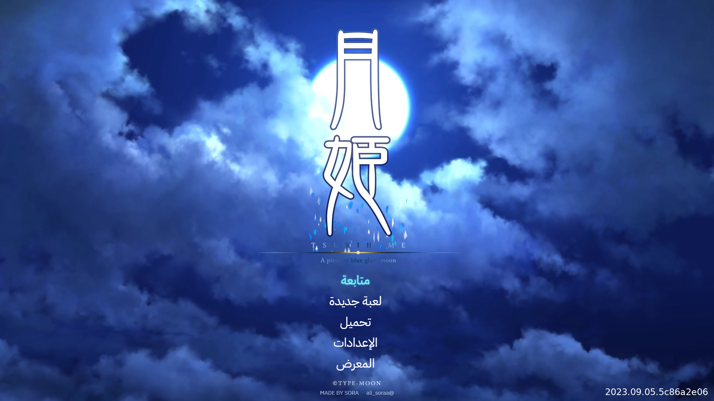
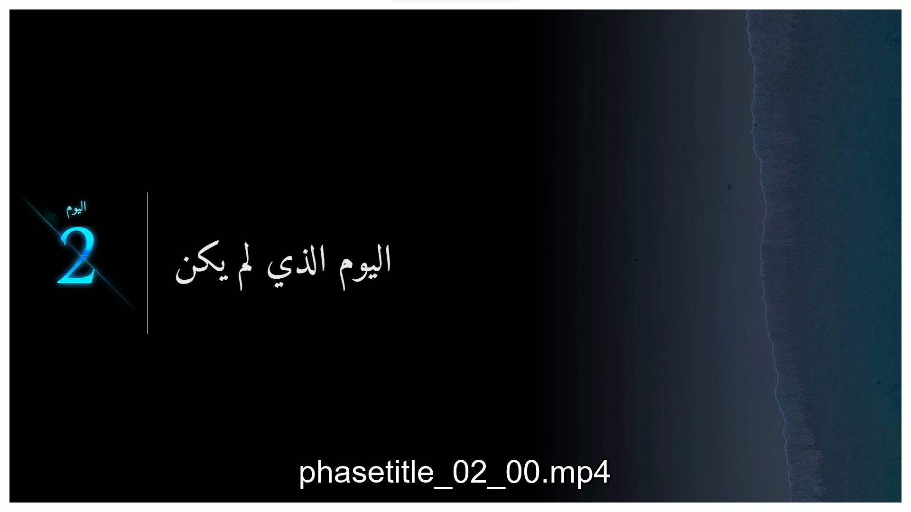
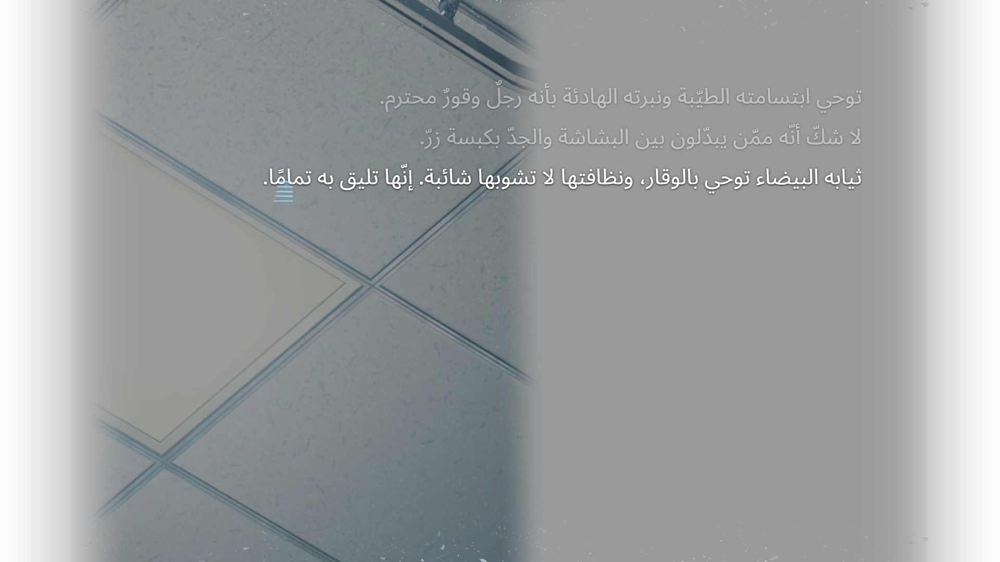
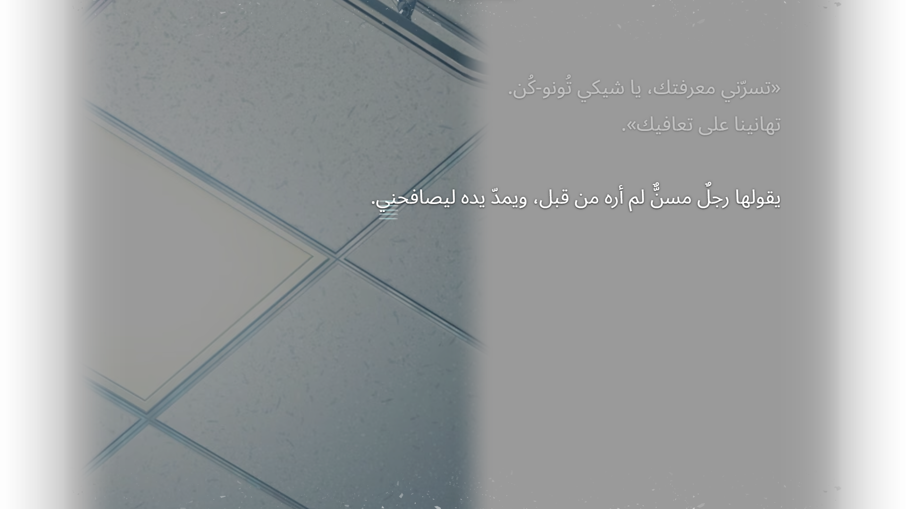
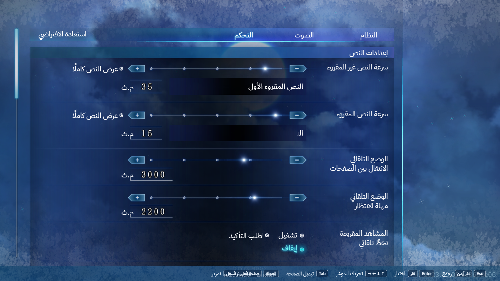
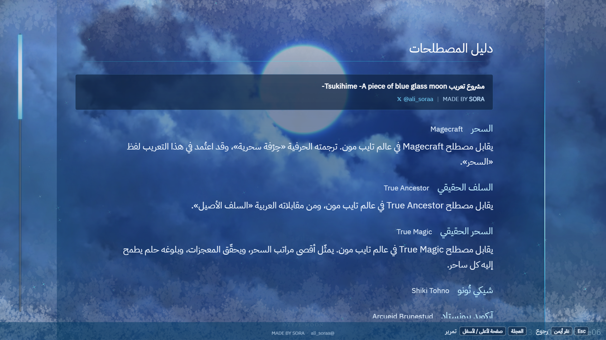

# تسوكِهيمِي: شَظِيّة من القمر الزجاجي الأزرق
### Tsukihime -A piece of blue glass moon- | Arabic Fan Translation

## نبذة عن المشروع

مشروع غير رسمي لتعريب لعبة **تسوكِهيمِي : شَظِيّة من القمر الزجاجي الأزرق** (نسخة الريميك).

## معلومات التعريب

ملفات تعريب تحافظ على اللغة الأصلية لملفات اللعبة (الإنجليزية) وتضيف إليها ترجمة عربية شاملة.

يشمل التعريب:
- جميع حوارات اللعبة.
- الواجهات والصور والمقاطع القصيرة.

**لا يشمل:** مقاطع الانترو ومقاطع الفيديو الطويلة، وقد تُضاف لاحقًا.

- يشمل دليلًا للمصطلحات لتوضيح بعض المفاهيم والكلمات التي اعتُمدت لها في الترجمة.
- يشمل ستة خطوط عربية للتبديل بينها أو تغيير حجمها.

التعريب متوافق مع نسخة البورت التي قام بها [waifwu](https://github.com/waifwu)، وهي نسخة [TsukiREbuild](https://github.com/waifwu/TsukiREbuild).

## منهجية التعريب

التعريب بالكامل منفذ بواسطة الذكاء الاصطناعي، على عدة طبقات متتالية لضمان جودته.

تم ضبط المصطلحات ومفاهيم عالم Type-Moon بالاستعانة بمكتبة WikiFandom (أعرف أنها وكر للهبد، لكنها أفضل من العدم)، وضبط منظور المتحدث والبلاغة العربية، والتخلص من أي ركاكة أو عرنجية في الحوارات.

أبلغني عند وجود أي أخطاء، سواء عبر Pull Request أو تويتر.

### طبقات العمل

- معجم العمل لمصطلحات Nasuverse.
- بعض الأجزاء الخاصة بالنكات والتفضيلات أثناء الترجمة.
- طبقة مراجعة للتأكد من وجود أسطر الترجمة في مكانها الصحيح، دون تأخير أو تقديم.
- طبقة للتخلص من العرنجية (أكبر مشكلة في الترجمات الآلية).
- طبقة لمراعاة الصوت الخاص بكل شخصية.

### الأدوات المستخدمة

- **GPT-6.1:** للبناء البرمجي وإضفاء دعم RTL.
- **Impeccable Skill:** للتحسينات المرئية بعد تعديل الواجهات.
- **FFmpeg:** لتعديل الصور.
- **APKTool وJava JDK:** فيما يخص نسخة Android.
- **Gemini 3.8:** للترجمة ومراحل التدقيق المتعددة.

## صور من التعريب

  
  
   
  
  
   
  
  

## متطلبات التشغيل

**Android:** إذا كنت تستخدمه في حياتك اليومية، فهو يكفي لتشغيل اللعبة.

**PC:** لو عندكم واحد قديم في المخزن، بيشغلها.

## كيفية التثبيت

1. نسخة Android: حملها من هنا (الرابط سيتوفر قريبًا).
2. نسخة PC: حملها من المستودع الأصلي للمشروع، تجده [هنا](https://github.com/waifwu/TsukiREbuild).
3. قم بتحميل التعريب من قائمة Release .
4. قم بفك الضغط عن ملف التعريب، وانسخ المجلد `www` إلى المسار التالي داخل ملفات اللعبة: `resources/`، واضغط على «استبدال الكل».

**ملاحظة:** لا تقم بحذف المجلد القديم أولًا، فقط انسخ المجلد الجديد إلى المسار، وستتكامل الملفات مع القديمة.

## التواصل

تواصل معي على تويتر: [@ali_soraa](https://x.com/ali_soraa).

## الحقوق والملكية

المشروع غير رسمي ولا يمثل الجهة الرئيسية للعمل. ادعموا الإصدار الأصلي للعمل: **Tsukihime -A piece of blue glass moon-**.

- **الترجمة الإنجليزية:** Tsukihimates Fan Translation Patch ([tsukihimates.com](https://tsukihimates.com/)).
- **ملفات اللعبة:** مشروع [TsukiREbuild](https://github.com/waifwu/TsukiREbuild).
- **الخطوط:** مكتبات عامة، أكيد مش مهتم تعرفها.
